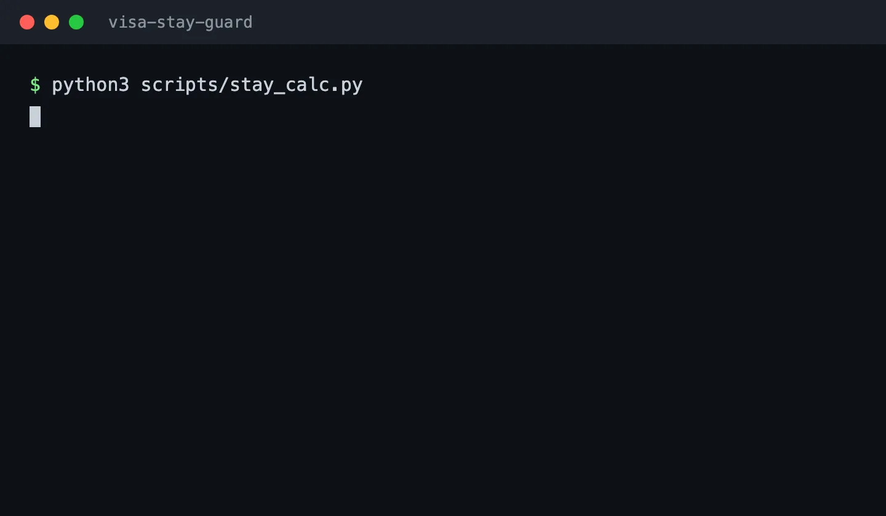

# visa-stay-guard · 算签证天数

> 213 个国家和地区规则（官方来源可点验）· 申根 90/180 精确算法 · 2233 个断言/场景通过 · 离线零依赖

离线算清「签证还能合法待几天」：报出入境行程，算出最晚离境日、90/180 滚动窗口
剩余、额度哪天开始逐日恢复、超期后果（按各国处罚条款如实告知）。



装给 AI Agent 用（Claude Code / Codex CLI / 其他兼容 Agent Skills 的客户端），
要求 agent 有本地脚本执行能力（一条 `python3`）。零依赖（纯 Python 标准库）、
不联网、毫秒级返回。中文口语日期直接吃：农历（初五 / 腊月 / 大年三十）、「18号」
这类说法都能定到具体某天，拿不准的先问再算。

## 凭什么信

- **213 个国家和地区**的停留规则，每条带官方来源链接与采集日期
  （official/government 级，可点验），不是「网上整理的表」。
- **104 国 224 条**具体签证类型，官方实抓与聚合整理分表分档、分开播报——
  聚合数据永远带「未逐条官方核验」标签，绝不混说成官方口径。
- **申根 90/180 精确算法**：35 国共享额度、跳国不清零（法国待满 90 天去
  西班牙，扣的还是同一个 90）；滚动额度逐日释放，同池跨境连续停留合并计算。
- **2233 个断言/场景通过**（`sh tests/run-all.sh` 可复跑）；
  农历表覆盖 1900–2100，与独立参考实现逐日比对 73372 天零误差。
- **敢说不知道**：护照/居留身份不适用、数据缺失、签证类型不匹配、口述与实算
  对不上时返回待确认状态，不给候选数字冒充最终结论；窗口耗尽直接返回阻断状态。

边界如实说：内置的是数据快照不是实时——某国昨天刚改政策它不知道，靠每条
数据自带日期与官方链接供你二次核对。不构成法律建议。

## TL;DR (English)

Offline Schengen 90/180 calculator as an Agent Skill (Claude Code / Codex CLI).
213 countries' stay rules with official sources, exact rolling-window math
(35-country shared quota, day-by-day recovery), Chinese colloquial dates
(lunar calendar included). Zero deps, pure Python stdlib, deterministic.

## 安装（装什么 · 装到哪 · 装完跑什么）

装什么：`SKILL.md` + `scripts/` + `references/` 三样（references 是数据文件，
**漏拷则查不到任何规则**）。装到哪：你 agent 的 skills 目录（下表选一）。
装完跑什么：一条冒烟命令，见下。

**人类最短路径（三条命令）：**

```bash
git clone https://github.com/nocaptain-oss/visa-stay-guard.git

# 按平台选一个 skills 目录（目录名固定 visa-stay-guard）
mkdir -p ~/.claude/skills/visa-stay-guard   # Claude Code
# ~/.codex/skills/visa-stay-guard/          # Codex CLI
# ~/.agents/skills/visa-stay-guard/         # 其他兼容 ~/.agents 约定的客户端

cp -r visa-stay-guard/SKILL.md visa-stay-guard/scripts visa-stay-guard/references \
      ~/.claude/skills/visa-stay-guard/

# 验证：在安装目录里跑，输出 JSON 含 "found": true 和 sourceUrl 即成功
cd ~/.claude/skills/visa-stay-guard
python3 scripts/visa_lookup.py --rules DE
```

**给 agent 的最短路径（直接对它说这句）：**

> 把 https://github.com/nocaptain-oss/visa-stay-guard 这个算签证天数的 skill
> 装进你的 skills 目录（SKILL.md、scripts/、references/ 三样都要拷），装完跑
> `python3 scripts/visa_lookup.py --rules DE` 验证，把安装位置和验证输出告诉我。

## 装完怎么用

跑通一条计算（申根场景，`status` 为正常状态且 `bottom_line` 非空即成功）：

```bash
python3 scripts/stay_calc.py <<'EOF'
{"country":"ES","today":"2026-10-26",
 "passport_nationality":"CN","passport_type":"ordinary","residence_status":"visitor",
 "rules":{"stay_single":90,"stay_window":180,"stay_window_max":90},
 "trips":[{"country":"FR","entry":"2026-06-01","exit":"2026-07-10"},
          {"country":"ES","entry":"2026-09-01","exit":null}]}
EOF
```

日常不用敲命令——对 agent 说「我申根还能待几天」「落地签能待多久」即触发
（触发词表见 SKILL.md frontmatter）。

## 作者的其他工具

- [css-canvas-inspector](https://github.com/nocaptain-oss/css-canvas-inspector) —
  固定尺寸 HTML 画布的可视化 CSS 检查器，人与 Agent 协作调样式

## 深读

- `skill_q.md` — 产品速览：数据架构、算法口径、口语日期处理、验证清单
- `REVIEW-BRIEF.md` — 真实场景与边界，含「它什么时候说不知道」

## 许可

内置规则数据 CC BY-NC-SA 4.0：个人学习须保留来源溯源链
（sourceName/sourceUrl），商业使用需另行授权。
计算结果仅供参考，不构成法律建议，请以边检入境章与使领馆官方信息为准。
